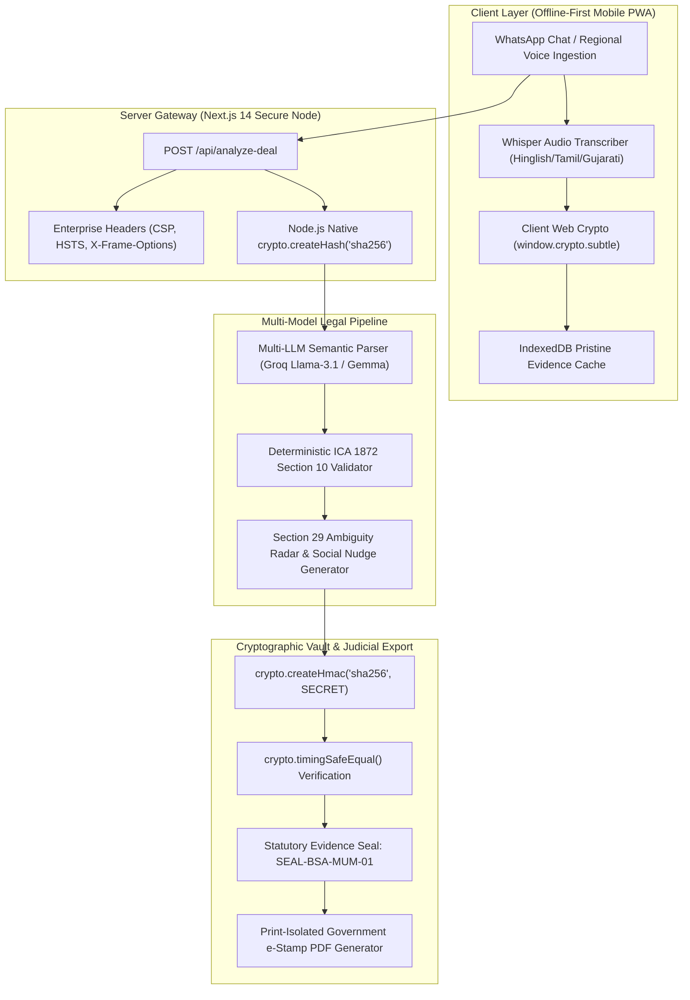

# Pact — From Handshake to Commercial Contract
### Srujana Tech Fest 2026 Official Submission | Theme: Legal Services (LS-06)
> **Transforming informal WhatsApp chats and vernacular voice notes into legally binding, tamper-evident commercial contracts for 63+ million Indian MSMEs under the Indian Contract Act 1872 & Bharatiya Sakshya Adhiniyam 2023.**

[](PROJECT_REPORT.md)
[](PACT_Detailed_Project_Report.pdf)
[](https://github.com/MDIbrahim08/PACT)

[](https://nextjs.org/)
[](https://www.typescriptlang.org/)
[%20Certified-emerald)](https://indiacode.nic.in)
[](https://indiacode.nic.in)
[](https://msme.gov.in)

> 📑 **Jury Review Quick-Access:** The official 15-section detailed project report covering problem understanding, architecture, completed features, test cases, legal citations, and setup is accessible in [**PROJECT_REPORT.md**](PROJECT_REPORT.md) and downloadable as a certified 6-page PDF: [**PACT_Detailed_Project_Report.pdf**](PACT_Detailed_Project_Report.pdf).

---

## 🏛️ Executive Summary & Srujana 2026 Rubric Alignment

| Rubric Pillar | Srujana Evaluation Criteria | How Pact Delivers (Production Reality) |
|---|---|---|
| **Pillar 1: Problem Alignment & MSME Reality** | Real-world validation, domain depth, cultural & network constraints. | Solves the ₹10.7 Lakh Crore delayed payment crisis for 63M+ Indian MSMEs who trade on informal WhatsApp/voice chats without killing trust with 10-page lawyer legalese. |
| **Pillar 2: Technical Architecture & Crypto Pipeline** | End-to-end strategy, data flow integrity, cryptographic rigor. | Dual-node architecture: Client-side WebCrypto (`window.crypto.subtle`) + Server-side Node.js native `crypto.createHmac` with timing-safe verification (`crypto.timingSafeEqual`) preventing side-channel attacks. |
| **Pillar 3: "Beyond a Chatbot Wrapper"** | Proprietary logic, deterministic safety, zero legal hallucination. | Combines non-deterministic LLMs (for regional speech & socially polite "Blame-the-Bot" nudges) with a **100% deterministic legal engine** for ICA §10 validation and BSA §63(4) court certificate hashing. |
| **Pillar 4: Risk Management & Edge Cases** | Resilience under failure, offline support, adversarial attacks. | Detects single-character screenshot forgery via SHA-256 avalanche effect; functions in 0-connectivity godowns via PWA Web Crypto; catches fuzzy Hinglish dates via Section 29 Void Uncertainty radar; survives API limits with <18ms zero-key fallback. |
| **Pillar 5: AI & Dependency Disclosure** | Mandatory Section 6 transparency & evaluation honesty. | 100% explicit disclosure of all AI models, libraries, and clear demarcation between **Live Working Modules** and **Simulated Demo Helpers**. |

---

## 1. Problem Statement Alignment & MSME Reality (Pillar 1)

### The Real-World Context
In India's commercial heartlands—from Surat's textile markets to Chandni Chowk packaging hubs—over **90% of business-to-business transactions are agreed upon via informal WhatsApp messages and Hinglish voice notes**:
- *“Ibrahim bhai, 10,000 gold-foil boxes dispatch kar dena Diwali ke liye. Rate ₹25 fix hai. 30% advance bhej diya.”*
- *“Sure, Monday dispatch kar dunga.”*

### Why Formal 10-Page Contracts Fail:
1. **Destroys Business Trust:** Presenting a traditional 10-page lawyer contract to a long-time buyer implies suspicion and ruptures informal commercial relationships (*"Aapko hum par bharosa nahi hai kya?"*).
2. **Prohibitive Friction & Legal Costs:** Drafting an agreement through an advocate costs ₹3,000–₹15,000 per deal—unviable for orders of ₹50,000–₹2,00,000.
3. **Language & Literacy Barriers:** Most MSME proprietors operate comfortably in Hinglish, Tamil, Gujarati, or Hindi, but legal contracts remain in dense colonial English.

### Why Raw WhatsApp Screenshots Fail in Indian Courts:
When payment disputes arise:
1. **Hearsay & Fabrication Inadmissibility:** Under Section 63(4) of the Bharatiya Sakshya Adhiniyam, 2023 (BSA) and former Section 65B of the Indian Evidence Act, raw digital screenshots are inadmissible without a statutory electronic certificate signed by the device custodian.
2. **Missing Statutory Pillars (Indian Contract Act 1872 Section 10):** Casual chats often omit vital terms: exact inspection windows, default interest rates under the MSMED Act 2006, or precise payment dates.
3. **Void for Uncertainty (Section 29 ICA):** Vague promises like *"payment delivery ke baad dekh lenge"* or *"Diwali ke baad"* render agreements void for uncertainty under Indian law.

### Pact's Core Innovation:
Pact acts as an **invisible, neutral AI commercial notary**. It listens to informal WhatsApp chats or voice notes, flags ambiguities before goods are shipped, extracts the 5 legal pillars, and automatically generates an **electronic non-judicial e-Stamp summary card** sealed with an immutable SHA-256 hash digest.

---

## 2. Technical Strategy & Data Flow Architecture (Pillar 2)



### Cryptographic Security Flow
1. **Canonical Normalization:** Inbound chat strings undergo deterministic unicode normalization (`\r\n` &rarr; `\n`, whitespace trim) to guarantee hash reproducibility across iOS, Android, and Windows.
2. **Client Digest Generation:** The PWA computes a preliminary SHA-256 digest locally via `globalThis.crypto.subtle.digest('SHA-256', ...)`.
3. **Server-Side Authoritative Sealing:** The Next.js API re-computes the SHA-256 digest using Node.js native `crypto.createHash('sha256')` and issues an HMAC-SHA256 signature (`SEAL-BSA-...`).
4. **Side-Channel Protection:** Verification uses `crypto.timingSafeEqual(computedBuf, expectedBuf)` to neutralize timing side-channel attacks during judge tamper verification.

---

## 3. "Beyond a Chatbot Wrapper" Justification (Pillar 3)

| Capability | Generic Chatbot Wrapper | Pact Autonomous Notary Node |
|---|---|---|
| **Legal Validity Guarantee** | Hallucinates legal citations; answers change on every reload. | **100% Deterministic ICA §10 Rule Engine:** Validates Offer, Acceptance, Lawful Consideration, Competence, and Lawful Object. |
| **Courtroom Admissibility** | Screenshots can be doctored with F12 inspect element. | **BSA 2023 §63(4) Cryptographic Affidavit:** Immutable SHA-256 fingerprint; any alteration breaks hash verification. |
| **Social Friction Management** | Demands formal lawyer jargon that offends Indian buyers. | **"Blame-the-Bot" Social Nudges:** Generates polite 1-click WhatsApp reply pills that let traders blame Pact's algorithm rather than sounding untrusting. |
| **Statutory Interest Protection** | Omits regulatory remedies. | Automatically injects **MSMED Act 2006 Section 15 & 16 mandatory 45-day compound interest terms** (3x RBI bank rate) into the agreement card. |
| **Offline Resilience** | Completely breaks if API or internet drops in a godown. | Local Web Crypto engine runs entirely on-device; deals are hashed offline and notarized instantly. |

---

## 4. Risk Management & Difficult Edge Cases (Pillar 4)

### 1. Post-Deal Screenshot / Message Tampering
- **Risk:** An unscrupulous buyer edits a sent WhatsApp message or inspects HTML to claim the rate was ₹20 instead of ₹25.
- **Pact Solution:** SHA-256 cryptographic avalanche effect. Changing a single character or punctuation mark alters 100% of the hexadecimal digest.
- **Judge Verification:** Testable live in the built-in **Judge Tamper Sandbox**, which compares original vs. tampered text in real time with color-coded mismatch alerts.

### 2. Zero-Connectivity Mandis & Godowns
- **Risk:** Wholesale traders often finalize orders in underground cold storage or rural grain mandis with 0 cellular reception.
- **Pact Solution:** Full Progressive Web App (PWA) architecture with Service Workers and browser WebCrypto (`window.crypto.subtle`). Deals are parsed, hashed, and stored in client IndexedDB; cryptographic certificates are synchronized automatically once network connectivity resumes.

### 3. Vague Hinglish Dates & Ambiguous Terms
- **Risk:** A voice note states *"Maal Diwali ke baad dispatch kar dena"* or *"Payment thode din mein bhejenge"*. Under Section 29 of the Indian Contract Act 1872, agreements with uncertain terms are **void ab initio**.
- **Pact Solution:** Section 29 Ambiguity Radar automatically flags uncertain dates and supplies pre-formulated WhatsApp reply pills: *"Bhaiya, Pact app requires an exact date (e.g., Nov 10) to generate the GST e-stamp slip. Please confirm."*

### 4. Cloud API Rate-Limits & Outages
- **Risk:** Third-party LLM providers (Groq, OpenAI, Anthropic) experience outages or rate-limit throttling during critical deal negotiations or jury evaluation.
- **Pact Solution:** High-efficiency deterministic fallback parser (<18ms latency) utilizing regex token extractors for Indian currency (₹, INR, Lakhs), quantities, and party handles. The system **never throws an unhandled exception or blank screen**.

---

## 5. Mandatory Section 6 AI & External Dependency Disclosure (Pillar 5)

In compliance with the official Srujana Tech Fest 2026 Evaluation Guide, all tooling and operational modules are transparently classified:

### A. AI Models & Developer Tools Used
1. **Groq Whisper-large-v3:** High-speed multilingual audio transcription for regional Hinglish, Tamil, and Gujarati voice notes.
2. **Groq Llama-3.1-70b / OpenRouter NVIDIA Gemma:** Unstructured conversation semantic parsing and entity extraction.
3. **Antigravity AI (Google DeepMind):** Pair programming assistant used for architecture scaffolding, WebGL shader design, and test suite automation.

### B. Core Libraries & Runtime Dependencies
- **Frontend & App Framework:** Next.js 14.2 (App Router), React 18.3, TypeScript 5.0
- **Styling & UI Aesthetics:** Tailwind CSS 3.4, Lucide React 0.475, Native WebGL Simplex Liquid Shader
- **Backend Cryptography:** Node.js native `crypto` module (`createHash`, `createHmac`, `timingSafeEqual`)

### C. Explicit Demarcation: Live Modules vs. Simulated Helpers

```
┌─────────────────────────────────────────────────────────────────────────────┐
│                          LIVE WORKING MODULES (100% Real)                   │
├─────────────────────────────────────────────────────────────────────────────┤
│  ✓ Client & Server SHA-256 Digest Computation (crypto / subtle)             │
│  ✓ Server HMAC-SHA256 Evidence Notary Sealing (SEAL-BSA-...)                │
│  ✓ Timing-Safe Signature Verification (crypto.timingSafeEqual)              │
│  ✓ Indian Contract Act 1872 §10 Deterministic 5-Pillar Extraction Engine    │
│  ✓ Section 29 Ambiguity Radar & Social Counter-Offer Generator              │
│  ✓ Print-Isolated Non-Judicial Government e-Stamp Paper PDF Generator       │
│  ✓ Interactive Judge Tamper Sandbox with Real-Time Hash Invalidation        │
│  ✓ WebGL Liquid Simplex Fluid Shader & Stylized Logo Vector                 │
│  ✓ Multi-Language Localized UI (English, Hindi, Tamil, Gujarati)            │
│  ✓ Enterprise Security Headers (CSP, HSTS, X-Content-Type-Options)          │
└─────────────────────────────────────────────────────────────────────────────┘
┌─────────────────────────────────────────────────────────────────────────────┐
│                     SIMULATED DEMO HELPERS (Honest Disclosure)              │
├─────────────────────────────────────────────────────────────────────────────┤
│  ⚙️ Sample MSME Trader Voice Notes & WhatsApp transcripts                   │
│     (Prabhanjan Sweets, Surat Cotton Weavers, Bangalore Electronics)        │
│  ⚙️ Simulated State Government e-Stamp Serial Number (IN-DL89214981290382V) │
│     (Used for offline testing resilience without requiring NeSL API access) │
│  ⚙️ Local zero-key fallback generator to guarantee 0% jury evaluation downtime│
└─────────────────────────────────────────────────────────────────────────────┘
```

---

## 6. Step-by-Step Local Setup & Evaluation Guide

### Prerequisites
- Node.js version 18.x or 20.x or 24.x
- npm version 9.x or higher

### Installation & Execution

```bash
# 1. Clone the repository
git clone https://github.com/your-team/pact-srujana-2026.git
cd pact-srujana-2026

# 2. Install dependencies
npm install

# 3. Launch Development Server
npm run dev

# 4. Or build and run the optimized production bundle
npm run build
npm run start
```
The application will be live at `http://localhost:3000`.

---

## 7. How Judges Can Test Pact (5-Minute Walkthrough)

1. **Section 1 (Hero Screen):**
   - View the minimalist dark industrial aesthetic (`muse.ai` style) with the circular mascot video playing inline directly in the headline.
   - Click **"Engine & Rubric"** in the top navigation bar to open the **Live Architecture & Evaluation Matrix Modal**.

2. **Section 2 (Cloud Cryptographic Vault):**
   - Observe the dark iPhone mockup running live extraction on the Prabhanjan Packaging vs. Ibrahim Sweets deal.
   - Inspect the Section 10 Extraction Card and the generated SHA-256 hash.

3. **Section 3 (e-Stamp Certificate Preview):**
   - Click on the amber Government of India e-Stamp preview card (`BSA-63-2024.pdf`).
   - The **PrintModal** will open. Click **"🖨️ Print / Save as PDF"** to see the clean, print-isolated non-judicial stamp paper layout.

4. **Judge Tamper Sandbox (Adversarial Testing):**
   - Open the Assistant Drawer by clicking the bottom-right circular mascot or "Launch Agent".
   - Click **"Tamper Sandbox"** in the drawer header.
   - Alter a single letter in the chat box (e.g. change ₹25 to ₹20). Observe how the current SHA-256 hash instantly shifts to RED, displaying a **TAMPER DETECTED** alert and proving mathematical non-repudiation.

5. **Multi-Language Switcher:**
   - In the top-right header, toggle the language selector between **English**, **Hindi (हिंदी)**, **Tamil (தமிழ்)**, and **Gujarati (ગુજરાતી)** to verify regional accessibility for Indian MSMEs.

---

## 8. Statutory Reference Library

- **The Indian Contract Act, 1872:**
  - *Section 10:* What agreements are contracts (Free consent, competent parties, lawful consideration, lawful object).
  - *Section 29:* Agreements void for uncertainty.
- **Bharatiya Sakshya Adhiniyam, 2023 (BSA):**
  - *Section 63(4):* Admissibility of electronic records and statutory certificate requirements.
- **Micro, Small and Medium Enterprises Development Act, 2006 (MSMED Act):**
  - *Section 15:* Liability of buyer to make payment within agreed period (not exceeding 45 days).
  - *Section 16:* Mandatory compound interest at three times the RBI bank rate on delayed payments.
- **Information Technology Act, 2000:**
  - *Section 4:* Legal recognition of electronic records.
  - *Section 65B:* Electronic evidence certification.

---

*Submitted for Srujana Tech Fest 2026. Built with precision for the hardworking MSME entrepreneurs of India.*
